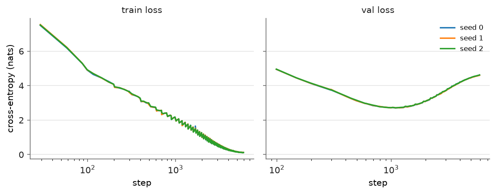
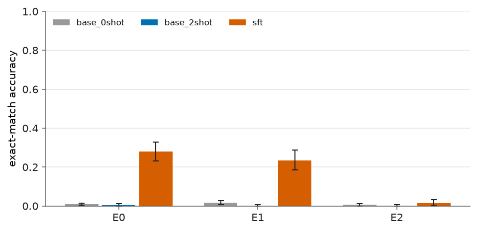
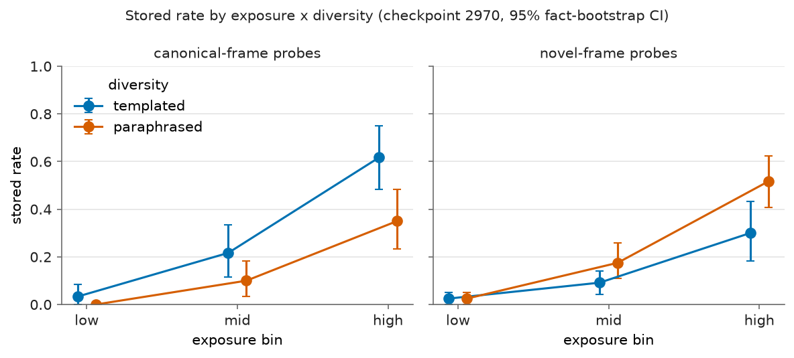
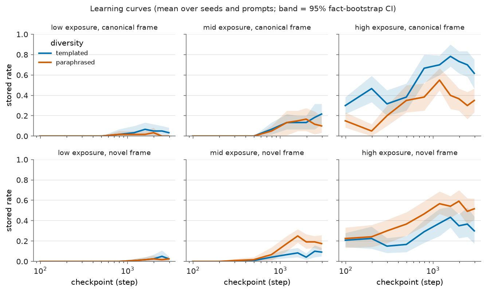

# What a small language model stores: exposure frequency and paraphrase diversity

CS 5370 course project report. Prajwal Srinivasamurthy, Sanskar Jadhav, Sri Charan Komati Reddy, Gourav Verma. Companion Animal Travel Desk knowledge base, decoder-only Transformer, pre-registered study.

## Dataset

We built a fictional organisation with one narrow department, the pet-travel desk of an airship line, and a knowledge base of 120 measured facts about it. Each fact is an (entity, attribute, value) triple whose value string is globally unique, so exposure can be counted by string match and contradictions can be detected. The facts are assigned to 6 design cells, three exposure bins crossed with two diversity conditions, with 20 facts per cell. In the templated condition the canonical fact sentence is used verbatim; in the paraphrased condition each mention is worded differently.

A generator model wrote 2,165 training documents of 11 document types (687,060 tokens in total), and validation and test sets of 120 and 120 documents. Templated fact sentences are 2.2% of corpus tokens, so the corpus as a whole is diverse and the templated condition is a small, deliberate contrast group. Exposure is measured as the string-match count of each value in the training documents.

## Research question

How do exposure frequency and paraphrase diversity during pretraining determine whether a small Transformer stores a fact, and does supervised fine-tuning make stored facts retrievable as answers to questions about facts it never saw in fine-tuning? A fact counts as stored only if its value ranks first among the same-attribute values and its binding score, the log-probability of the value given the right entity minus its mean given the other entities, is above zero. The binding score removes the frequency prior: a common value cannot count as recalled just because the model emits it for every entity.

We pre-registered four hypotheses. **H1:** storage rises with log exposure. **H2:** at matched exposure, paraphrased facts generalise better to novel-frame probes and templated facts do better only on canonical-frame probes, tested as the diversity by frame interaction. **H3:** held-out question accuracy after fine-tuning (E2) exceeds the base model but is bounded by pre-fine-tuning storage. **H4:** the extraction gain is larger for paraphrased facts. H1 to H3 are confirmatory with a Holm correction; H4 is secondary and reported as an effect with its interval only, because its power at this sample size is low.

## Architecture

The model is a decoder-only Transformer with 6 layers, model width 384, 6 attention heads, a context of 512 tokens and a byte-pair vocabulary of 4,096 tokens, giving 12,417,024 parameters. The token embedding (V x d_model) and the LM head (d_model to V) are tied: they are one 4,096 x 384 matrix. It is trained from random initialisation with next-token cross-entropy and runs on a CPU for the released checkpoints.

## Training procedure

Pretraining runs 60 epochs on 3 seeds with a learning rate of 0.001, chosen in a sweep of 7 configurations. The analysed checkpoint, E\* = epoch 30, was chosen by the pre-registered rule on the smoothed validation-probe stored rate: the earliest checkpoint within one SE of the best (0.273, SE 0.032; epoch 30: 0.251). Epochs 12 and 60 are sensitivity checks. E\* is also the start of fine-tuning and the source of each fact's pre-fine-tuning storage status. The primary fine-tuning is early-stopped on a 12-fact validation set (epochs 1, 2, 1 for seeds 0-2; learning rate 0.0001, loss on answer tokens only); a fixed 3-epoch fine-tuning is post-hoc secondary. Validation loss is 3.68 at E\*; at epoch 60 the training loss is 0.12 and the validation loss 4.61 (perplexity 100.6).

## Evaluation

Storage is probed with cloze prompts in two frames, the canonical sentence prefix and a novel wording, using test templates only; validation templates are used for model selection and never for results. Extraction is measured on three question sets: E0 (fine-tuning facts, training phrasings), E1 (fine-tuning facts, unseen phrasings) and E2 (held-out facts never seen in fine-tuning), for the base model with zero and two examples and for the fine-tuned model.

H1 and H2 use a logistic model for stored with fact clusters (a GEE, because three seeds cannot support a random-effect variance), with exposure, diversity, frame, their interactions, covariates and template terms. H3 and H4 use fact-level outcomes on E2: a fact is stored, or correct, when that holds for at least two of its three probes or phrasings and in a majority of seeds. H3 combines an exact McNemar test (base against fine-tuned) with a Fisher exact test (stored against correct); H4 is a permutation test on the per-fact gain. Sensitivity analyses vary the aggregation rule, the exposure coding, the template terms, the estimator, the outcome definition and the diversity measure.

## Findings

The analysed checkpoint is step 2,970 (epoch 30 = E\*), with 120 facts and 3 seeds. Overall the stored rate across design cells is 0.20.

- H1: estimate 0.95 log-odds per tripling of exposure, 95% CI 0.37 to 1.53; Holm-adjusted p 0.00325; outcome: supported.
- H2: estimate 1.84 log-odds for the diversity x frame interaction (paraphrased advantage, novel minus canonical), 95% CI 0.91 to 2.78; Holm-adjusted p 0.000516; outcome: supported.
- H3: estimate 0.00 risk difference for the SFT gain on E2 (SFT minus 2-shot base), 95% CI 0.00 to 0.00; Holm-adjusted p 1; outcome: not supported; CI inside margin.
- H4: primary estimate 0 (95% CI 0 to 0) for the gain difference (paraphrased minus templated), because all fact-level outcomes are zero; the supplementary item-level estimate is -0.019 (-0.056 to 0.007). Secondary: effect and CI only.

**Table 1.** Hypotheses H1-H4. H1-H3 are confirmatory (Holm adjusted); H4 is secondary (effect and CI only). Estimates are log-odds (H1, H2) or risk differences (H3, H4).

| hypothesis | label | estimate | ci_low | ci_high | p_holm | status |
|---|---|---|---|---|---|---|
| H1 | storage rises with log exposure (per tripling) | 0.948 | 0.369 | 1.53 | 0.00325 | supported |
| H2 | diversity x frame (paraphrased advantage, novel - canonical) | 1.84 | 0.91 | 2.78 | 0.000516 | supported |
| H3 | E2 gain after SFT, bounded by pre-SFT storage (IUT) | 0 | 0 | 0 | 1 | not supported; CI inside margin |
| H4 | extraction gain larger for paraphrased (secondary) | 0 | 0 | 0 | n/a | secondary: effect and CI only (all-zero data) |

For H2 the effect of diversity within each frame, paraphrased minus templated at mid exposure, is -1.22 log-odds on canonical probes (95% CI -2.13 to -0.31) and 0.62 on novel probes (95% CI -0.05 to 1.30). On the risk-difference scale, high against low exposure changes the stored rate by 0.42 (95% CI 0.35 to 0.50).

On E2 the fine-tuned model reaches 0.01 exact-match accuracy against 0.00 for the two-shot base model and 0.01 for the zero-shot base; on the fine-tuning facts it reaches 0.28 (E0) and 0.23 (E1). Among the 60 held-out facts, the difference in correctness between stored and not-stored facts is 0.00 (95% CI 0.00 to 0.00).

**Table 2.** E2 held-out facts by diversity condition: base (2-shot) and SFT fact-level accuracy, gain and the exact McNemar test.

| div_bin | n_facts | acc_base | acc_sft | gain | mcnemar_p |
|---|---|---|---|---|---|
| templated | 30 | 0 | 0 | 0 | 1 |
| paraphrased | 30 | 0 | 0 | 0 | 1 |

Replacing the nominal diversity label by the realized diversity of the generated mentions changes the H2 estimate from 1.84 to 0.04 log-odds per nominal contrast. The full set of sensitivity analyses follows; none of them is part of the confirmatory family.

**Table 3.** Pre-registered sensitivity analyses (none is part of the Holm family).

| analysis | hypothesis | estimate | ci_low | ci_high |
|---|---|---|---|---|
| primary (GEE, log3 mentions if present, with templates) | H1 | 0.948 | 0.369 | 1.53 |
| primary (GEE, log3 mentions if present, with templates) | H2 | 1.84 | 0.91 | 2.78 |
| exposure coding: bins | H1 | 0.946 | 0.369 | 1.52 |
| exposure coding: bins | H2 | 1.85 | 0.911 | 2.78 |
| exposure coding: measured | H1 | 0.948 | 0.369 | 1.53 |
| exposure coding: measured | H2 | 1.84 | 0.91 | 2.78 |
| without prompt_variant terms | H1 | 0.94 | 0.359 | 1.52 |
| without prompt_variant terms | H2 | 1.84 | 0.914 | 2.76 |
| Bayesian mixed logit (fact, fact x seed; point estimate) | H1 | 1.29 | n/a | n/a |
| Bayesian mixed logit (fact, fact x seed; point estimate) | H2 | 2.2 | n/a | n/a |
| outcome: stored_tokennorm | H1 | 0.993 | 0.527 | 1.46 |
| outcome: stored_tokennorm | H2 | 1.47 | 0.86 | 2.09 |
| realized diversity replaces div_bin | H2 (scaled to nominal contrast) | 0.0371 | -0.00813 | 0.0823 |
| realized diversity replaces div_bin | H1 | 0.936 | 0.391 | 1.48 |
| div_bin and realized diversity together | H2 (nominal term given realized) | 1.84 | 0.911 | 2.78 |
| div_bin and realized diversity together | H2 (realized term, per SD) | 0.0438 | -0.36 | 0.448 |
| fact-level rule: any | H3 (gain) | 0.0667 | 0 | 0.15 |
| fact-level rule: any | H4 | -0.0667 | -0.2 | 0.1 |
| fact-level rule: majority (primary) | H3 (gain) | 0 | 0 | 0 |
| fact-level rule: majority (primary) | H4 | 0 | 0 | 0 |
| fact-level rule: all | H3 (gain) | 0 | 0 | 0 |
| fact-level rule: all | H4 | 0 | 0 | 0 |
| comparator: base_0shot (secondary) | H3 (gain) | 0 | 0 | 0 |
| comparator: base_0shot (secondary) | H4 | 0 | 0 | 0 |

## Generated samples

The gallery contains 2 successes and 8 failures, grouped by the failure categories wrong fact, wrong attribute, entity confusion, repetition loop and format drift.

**Table 4.** Generated-text samples: successes and failures.

| category | prompt | completion | note |
|---|---|---|---|
| success: recalled fact | Question: Quick question: I need the pet cabin capacity of the Cloudre | The pet cabin aboard the Cloudrest holds 73 pets. | SFT, held-out fact F034, seed 0: value matches the KB and no rival value appears |
| failure: wrong attribute | Question: For my records, I need the maximum combined weight for a lar | The longest crate side for a small dog is 67 kg. | SFT, held-out fact F063, seed 0: value 67 kg is right, but the answer names another attribute and entity |
| success: recalled fact | How old does a small dog have to be before it can fly? At least | 10 weeks old, travelers need clear guidance before arrival, so please  | pretrained seed 0, checkpoint 495 (epoch 5), t0.8: value_correct |
| failure: entity confusion | Question: For my records, give me the daily pet capacity at Thornwick. | The daily pet capacity at Ashenfell is 285 pets. | SFT, held-out fact F010, seed 0: a value of another entity of the same attribute |
| failure: entity confusion | Question: Quick question: I need the relief-area gate for Caldreth. An | The relief-area gate at Thornwick is RG-847. | SFT, held-out fact F013, seed 0: a value of another entity of the same attribute |
| failure: format drift | The cabin temperature aboard the Halcyon is set to | gothing especially� chain departures fas pref�omfortpectReaders� depen | pretrained seed 0, checkpoint init (epoch 0), t0.8: gibberish |
| failure: format drift | The pet lounge at Port Isolde opens at | ultout when a others to are nightTravelers | pretrained seed 0, checkpoint 99 (epoch 1), t0.8: gibberish |
| failure: format drift | Passengers with animals on the Moonwake board by way of the deck named | recent supplies about the matter | pretrained seed 0, checkpoint 198 (epoch 2), t0.8: gibberish |
| failure: wrong fact | Question: For my records, tell me who runs the pet lounge at Caldreth. | The relief-area gate at Thornwick is RG-847. | SFT, held-out fact F001, seed 0: no value of this attribute, or not the right one |
| failure: wrong fact | Question: Quick question: I need to know the lounge manager at Caldret | The relief-area gate at Thornwick is RG-847. | SFT, held-out fact F001, seed 0: no value of this attribute, or not the right one |

## Limitations

The corpus comes from a single generator model and is synthetic, the study is small, and exposure is a string-match count, so a value stated in an unusual way is missed. Templated and paraphrased facts differ in sentence-context variety as well as in wording; we state this rather than hide it. Fact-level outcomes discard item-level information to keep facts independent, and the McNemar and Fisher tests are conservative at this size. E2 has 60 facts, so H4 is secondary and every H3 and H4 interval is wide. The analysis was fixed in a pre-registration before any result was seen; the pre-registration commit is e1dce48c98ccad02fcc1b7191b56e748ddae17c7; the analysis code is commit 5c94523 plus freeze addendum R08-1.

## Appendix A: limitations, continued

**Value length is confounded with exposure by design.** Of the 40 facts in each exposure bin, the number whose value is the shortest (or tied shortest) of its attribute is 0 (low), 4 (mid) and 40 (high); mean value length is 4.12, 3.62 and 2.25 tokens. The probe score is a summed log-probability, so an untrained model can rank only a shortest value first, which is why it already scores above chance in the high bin. The primary model adjusts for value length, which is partly collinear with exposure (Table A2).

**Early-stopped SFT, 12-fact validation set.** Early stopping used the loss on 12 held-out facts absent from the SFT training data, so that loss cannot fall as the training facts are learned. It picked epoch 1, 2, 1 for seeds 0, 1, 2 (training-question exact match 0.12, 0.56, 0.15). This pre-specified SFT is primary; a post-hoc fixed three-epoch SFT (three-epoch cosine schedule, otherwise identical) is secondary (Table A3).

**Three seeds, one model size, memorization.** Validation loss is lowest at epoch 12 and rises afterwards (2.72, 3.69 and 4.61 at epochs 12, 30 = E\*, 60) while the stored rate stays within its standard error (Table A1): a memorization regime.

**Data and model.** Bank sentence defect rate about 3% (60-sentence sample, not re-measured); weak sentence diversity for four facts (F040, F087, F021, F067); twelve flagged validation and test documents kept (held-out loss without the five flagged validation documents differs by at most 0.01); H1 and H2 use a GEE, not a mixed model. The test-access ledger has five lines; the fourth (the post-hoc fixed three-epoch SFT evaluation) recorded git dirty = true because the taxonomy relabelling was uncommitted when it ran; results are unaffected.

## Appendix B: post-unblinding correction of H1 and H2

After the results were seen, an audit found that a boolean outcome made the formula interface model the probability of NOT stored, so every logistic coefficient had the wrong sign. The fix (validated on synthetic planted effects, not on these outcomes) changes only signs; the hypotheses, model, margins and E\* are unchanged, and a freeze addendum records the code change. Original numbers:

| hypothesis | original (bugged, sign inverted) | corrected |
|---|---|---|
| H1 (primary, E\*) | -0.948 (-1.528, -0.369), Holm p 0.0032 | +0.948 (+0.369, +1.528), Holm p 0.0032 |
| H2 (primary, E\*) | -1.844 (-2.778, -0.910), Holm p 0.00052 | +1.844 (+0.910, +2.778), Holm p 0.00052 |
| H1 (secondary, epoch 60) | -1.164 (-1.707, -0.621), Holm p 0.00016 | +1.164 (+0.621, +1.707), Holm p 0.00016 |
| H2 (secondary, epoch 60) | -1.624 (-2.512, -0.737), Holm p 0.00093 | +1.624 (+0.737, +2.512), Holm p 0.00093 |

## Appendix C: supplementary tables (post-unblinding, outside the Holm family)

**Table A1. Stored rate at checkpoints (descriptive, no tests).** Test probes, three seeds; rate with the chance rate in brackets.

| checkpoint | all | low | mid | high |
|---|---|---|---|---|
| init | 0.104 (0.096) | 0.000 (0.107) | 0.025 (0.120) | 0.286 (0.060) |
| epoch 12 (validation-loss optimum) | 0.220 (0.071) | 0.014 (0.081) | 0.125 (0.086) | 0.522 (0.045) |
| epoch 30 (E\*) | 0.199 (0.079) | 0.022 (0.096) | 0.142 (0.089) | 0.433 (0.051) |
| epoch 60 | 0.218 (0.081) | 0.039 (0.097) | 0.150 (0.091) | 0.464 (0.054) |

**Table A2. How much of H1 survives value length.** H1 per tripling of exposure at epoch 30, logistic GEE (log-odds) and linear-probability GEE (risk difference); 95% CIs.

| model | H1 log-odds | H1 risk difference |
|---|---|---|
| primary (value length, entity frequency, attribute effects) | +0.95 (+0.37, +1.53) | +0.143 (+0.093, +0.193) |
| no value-length covariate | +1.79 (+1.31, +2.28) | +0.213 (+0.175, +0.251) |
| mid versus low only, with value length | not estimable (the low bin has almost no stored rows) | +0.116 (+0.072, +0.160) |
| high versus mid only, with value length | +0.20 (-0.92, +1.32) | +0.110 (-0.025, +0.244) |

Mid and low facts do not differ clearly in value length (3.62 against 4.12 tokens, Mann-Whitney p = 0.12), so the mid-versus-low contrast is the cleanest exposure comparison. The high-versus-mid step cannot be separated from value length in this design.

Init-adjusted analyses (secondary): the change in stored rate from init to E\* gives H1 +0.025 (-0.026, +0.076) and H2 +0.225 (+0.125, +0.325) (risk differences); the primary logistic model with init stored as a covariate gives H1 +0.934 (+0.497, +1.370) and H2 +1.848 (+0.949, +2.748) (log-odds).

**Table A3. Early-stopped SFT (pre-specified, primary) against a post-hoc fixed three-epoch SFT (secondary).** Exact value match; base rows are the same in both.

| model | E0 | E1 | E2 |
|---|---|---|---|
| base zero-shot | 0.008 | 0.016 | 0.006 |
| base 2-shot | 0.005 | 0.002 | 0.002 |
| SFT, early-stopped (primary) | 0.280 | 0.234 | 0.015 |
| SFT, fixed 3 epochs (post-hoc) | 0.851 | 0.704 | 0.028 |

| H3 on E2 facts (60) | early-stopped (primary) | fixed 3 epochs (post-hoc) |
|---|---|---|
| McNemar: both / base only / SFT only / neither; exact p | 0 / 0 / 0 / 60; 1 | 0 / 0 / 0 / 60; 1 |
| Fisher stored x correct: stored right / wrong, not stored right / wrong; p | 0 / 7, 0 / 53; 1 | 0 / 7, 0 / 53; 1 |
| item-level E2 gain over base 2-shot (95% fact-bootstrap CI) | +0.013 (+0.000, +0.031) | +0.026 (+0.007, +0.048) |

No fact reaches the majority rule under either SFT, so the fact-level H3 intervals are degenerate; the item-level row is secondary.

Table A4 (SFT error classes and ranking MRR for both SFT variants) is in the supplementary file reports/integration/r08/supplementary_tables_R08.md.
